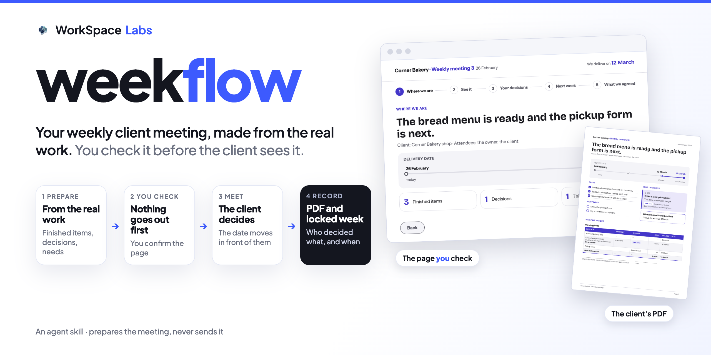

# weekflow



*Sample pages. Your meeting follows your project's own design.*

**A skill for running weekly client meetings.** The agent prepares the
meeting from the project's real work. The owner reads and confirms the
page before showing it in the meeting or sending anything to the client.

## What you get

These files go in the project you are meeting about. The number in each
file name is the meeting number, starting at 1.

| File | What it holds |
| --- | --- |
| `docs/weekly/pages/week-<number>.html` | The offline meeting page the owner opens in a browser. |
| `docs/weekly/pages/week-<number>.pdf` | The PDF the owner can send to the client after confirmation. |
| `docs/weekly/pages/week-<number>-content.json` | The saved meeting content used for the HTML and PDF. |
| `docs/weekly/weeks/week-<number>.json` | The week's record, including who attended, what they decided and when the week was locked. |
| `docs/weekly/project.json` | Setup, including the meeting day, language and delivery date when known. |
| `docs/weekly/changes.json` | Changes raised during the build and their decisions. |
| `docs/weekly/promises.json` | What was promised and how it turned out. |
| `docs/weekly/screens.json` | The ordered screen map. Saved pictures go in `docs/weekly/screens/`. |
| `docs/weekly/corrections.json` | Dated corrections and removals when needed. |

## How it works

**Docs meetings** come before the scope is approved. The client reads
the real documents and answers open questions. Scope approval happens
through the project's meeting form. **Build meetings** start with an
approved `docs/prd.md`. The client tries the work and sees how each
change decision affects the delivery date.

1. **Where we are.** See the week's progress, the project's stage and,
   in a build meeting, the delivery date.
2. **See it.** Read the document sections or see the real work. The build
   page can show dated screenshots and mark designs that are still unbuilt.
3. **Your decisions.** Answer open questions or decide which changes to
   make. The page updates the open question count or running delivery date.
4. **Next week.** See what is planned and what the client needs to provide.
5. **What we agreed.** Review the choices. The owner can press **Save answers**
   to download them, or read them back to the agent if scripts are off.

Before the meeting, the owner checks the page and confirms that version.
The HTML stays with the owner. After the meeting, the agent records the
answers, attendees and who decided. It makes the client PDF from the same
saved meeting content as the page. A build decision that moves the delivery
date needs the client's signature on paper. Once the current PDF and any
required signature are recorded, the owner can close and lock the week.

At the close of a build week, the agent shows which agreed changes need an
update to the project requirements document (PRD), including earlier decisions
still waiting. It offers to hand the details to project-docs. When project-docs
records the change ID in the PRD's dated change history, the item leaves the
handoff list. Work on that change waits for the designated approver to approve
the revised requirement and its check, even when the change adds zero days.

Open decisions, promises and outstanding needs carry forward. A missed
meeting gets its own record. A mistake in a locked week gets a dated
correction. At the end of the build, the owner confirms the changes,
delays and dates before the agent hands them to checkflow for the final
delivery check.

## Passwords and keys

The secret check is **a safety net, not a guarantee**. When a draft
contains a value the check recognises as a secret in the project's
`.env` or `.env.*` files, preparation stops. The refusal identifies
where to look without printing the value. The check can miss credentials
under unfamiliar names or in other files. Keep passwords, keys and
tokens out of drafts. Read the page and check pictures for customer data
before showing them, and read the PDF before sending it.
[Security rules](docs/security.md) · [How the check works](docs/adr/033-identify-secret-settings.md)

## Install

Use Python 3.9 or newer. The meeting page uses Python alone. For
`client-copy`, use a Python with ReportLab installed. Recent ReportLab
releases need Python 3.10 or newer, so on Python 3.9 install
`"reportlab<4.3"`. The commands
below use `python3` on Mac and `py -3` on Windows. Check the version
with `python3 --version` or `py -3 --version`. The `py` launcher comes
with the python.org installer. If Python came from the Microsoft Store,
use `python` in place of `py -3`.

The one-line install needs Node.js with `npx`. The by-hand install needs Git.

The planned release address is
[workspace-labs/weekflow](https://github.com/workspace-labs/weekflow).
The GitHub commands are for that release.

**One-line install**

If you already have a copy, back it up and move it before installing again.
The command installs for Claude Code and Codex. On Mac:

```sh
(for weekflow_dir in .agents .claude .codex; do weekflow_copy="$HOME/$weekflow_dir/skills/weekflow"; if [ -e "$weekflow_copy" ] || [ -L "$weekflow_copy" ]; then printf '%s\n' "weekflow is already installed. Move that copy first." >&2; exit 1; fi; done; npx skills add workspace-labs/weekflow --skill weekflow -a claude-code -a codex -g)
```

In PowerShell:

```powershell
if (Get-Item -LiteralPath "$HOME/.agents/skills/weekflow","$HOME/.claude/skills/weekflow","$HOME/.codex/skills/weekflow" -Force -ErrorAction SilentlyContinue) { throw "weekflow is already installed. Move that copy first." } else { npx skills add workspace-labs/weekflow --skill weekflow -a claude-code -a codex -g }
```

**By hand for Claude Code or Codex**

Start in a folder where you can make a checkout named `weekflow`. Choose
one target. The first line is for Claude Code. For Codex, use the second
line instead. On Mac:

```sh
weekflow_target="$HOME/.claude/skills/weekflow"
# weekflow_target="$HOME/.agents/skills/weekflow"
if [ -e "$weekflow_target" ] || [ -L "$weekflow_target" ]; then
  printf '%s\n' "weekflow is already there. Back up and move that copy first." >&2
  false
else
  git clone https://github.com/workspace-labs/weekflow.git weekflow &&
    mkdir -p "$(dirname "$weekflow_target")" &&
    cp -R weekflow/skills/weekflow "$weekflow_target"
fi
```

In PowerShell, choose the target the same way:

```powershell
$weekflowTarget = "$HOME/.claude/skills/weekflow"
# $weekflowTarget = "$HOME/.agents/skills/weekflow"
if (Get-Item -LiteralPath $weekflowTarget -Force -ErrorAction SilentlyContinue) {
    throw "weekflow is already there. Back up and move that copy first."
}
git clone https://github.com/workspace-labs/weekflow.git weekflow
if ($LASTEXITCODE -ne 0) { throw "Could not clone weekflow." }
New-Item -ItemType Directory -Path (Split-Path -Parent $weekflowTarget) -Force -ErrorAction Stop | Out-Null
Copy-Item -LiteralPath weekflow/skills/weekflow -Destination $weekflowTarget -Recurse -ErrorAction Stop
```

Open a new agent session in the folder you want to work in.

**ZIP for chat apps**

From the folder containing this README, make `dist/weekflow.zip`.
If your chat app supports uploading skills, upload it in the app's
Skills settings. The app needs a Python environment that can run the
skill and access the project. On Mac:

```sh
if [ -e dist/weekflow.zip ] || [ -L dist/weekflow.zip ]; then
  printf '%s\n' "dist/weekflow.zip already exists. Move it first." >&2
  false
else
  mkdir -p dist && (cd skills && zip -r -X ../dist/weekflow.zip weekflow -x '*/__pycache__/*' '*.pyc' '*.DS_Store')
fi
```

In PowerShell, use a fresh checkout so the ZIP contains only the skill:

```powershell
if (Get-Item -LiteralPath dist/weekflow.zip -Force -ErrorAction SilentlyContinue) {
    throw "dist/weekflow.zip already exists. Move it first."
}
New-Item -ItemType Directory -Path dist -Force -ErrorAction Stop | Out-Null
Compress-Archive -LiteralPath skills/weekflow -DestinationPath dist/weekflow.zip -ErrorAction Stop
```

## Use it

Ask in the project folder. [Skill instructions](skills/weekflow/SKILL.md)

> Use weekflow to prepare this week's client meeting for this project.

The agent reads the project, asks for missing details and opens the draft.
Check that the dates, progress, decisions and pictures match what you want
to show. Tell the agent when you confirm the version you read.

The agent runs `scripts/weekflow.py` from the installed skill. Put the
project folder after the command name.

| Command | When to use it |
| --- | --- |
| `start` | Set up weekly meetings. |
| `enter-build` | Start build meetings after scope approval and close of the last docs week. |
| `correct-date` | Correct the starting delivery date before the first build week is recorded. |
| `change` | Record a build change for the client to decide. |
| `screens-from-flow` | Import an ordered list of screens from the project's app flow. |
| `screen` | Add or update a screen in the build meeting's screen map. |
| `screen-picture` | Attach a dated screenshot or an approved design to a screen. |
| `screen-check` | Record that the owner checked a saved screen picture for customer data. |
| `check-promise` | Record whether a promise from an earlier week was finished. |
| `prepare` | Make or update the owner's meeting page. |
| `confirm` | Record the owner's approval of this version. |
| `record` | Save the actual meeting answers and who took part. |
| `client-copy` | Make the PDF after confirmation. Make it again after recording to show what happened. |
| `sign` | Record the client's paper signature when the build date moved. |
| `lock` | Close the week after the PDF and any required signature. |
| `no-meeting` | Record a missed meeting and carry open items forward. |
| `correct` | Add a dated correction for a locked week. |
| `remove-name` | Record a dated removal of a name from weekly history. |
| `remove-picture` | Record a dated removal of a saved picture from weekly history. |
| `handoff` | Read the locked dates and changes for checkflow. |

When `prepare` asks about colours, choose `--colors standard` or give your main
colour with `--main-color '#RRGGBB'`. You can also give `--background-color`
and `--text-color` with the main colour. Weekflow remembers your choice in the
weekly records. A usable project `DESIGN.md` takes precedence. Change the
choice on an unconfirmed draft or the next week.

### Try it first

Make a new folder called `corner-bakery-sample` for this made-up project.
Inside it, make a `docs` folder and save this as `docs/prd.md`.

```markdown
# PRD: Corner Bakery
> v1 · Approved 2027-02-08 by the client

- **Dates:** Ready for pickup orders by 2027-03-12.
```

Save this as `menu.txt` at the top of the sample folder.

```text
Today's menu lists oat bread and spice buns.
```

Open an agent session in that folder and say:

> Use weekflow to start Friday meetings in English for the client, with the owner and the client attending, and prepare the meeting dated 2027-02-26.

The agent should read back the delivery date from the PRD, use the sample
menu as evidence and open `docs/weekly/pages/week-1.html` in a browser.
Check that the page shows Corner Bakery, the menu and the five steps.

**Try it from a terminal**

You can also do the same trial by hand in a fresh sample folder. Start in
the folder that contains `corner-bakery-sample`. Set the install target
from **Install** in the same terminal. Run setup and make the draft folder.
On Mac:

```sh
sample="$PWD/corner-bakery-sample"
python3 "$weekflow_target/scripts/weekflow.py" start "$sample" --meeting-day Friday --language en --client 'the client' --attendee 'the owner' 'the client'
mkdir -p "$sample/docs/weekly/pages"
```

In PowerShell:

```powershell
$sample = Join-Path (Get-Location) corner-bakery-sample
py -3 "$weekflowTarget/scripts/weekflow.py" start $sample --meeting-day Friday --language en --client 'the client' --attendee 'the owner' 'the client'
New-Item -ItemType Directory -Path "$sample/docs/weekly/pages" -Force | Out-Null
```

Save this as `docs/weekly/pages/draft.json` inside the sample folder.

```json
{
  "headline": "The bakery menu is ready.",
  "finished": [
    {"text": "The menu lists oat bread and spice buns.", "source": "menu.txt"}
  ],
  "next_week": [{"text": "Draft the pickup form."}],
  "needs": [],
  "received": []
}
```

Make the page. On Mac:

```sh
python3 "$weekflow_target/scripts/weekflow.py" prepare "$sample" --date 2027-02-26 --content docs/weekly/pages/draft.json --colors standard
```

In PowerShell:

```powershell
py -3 "$weekflowTarget/scripts/weekflow.py" prepare $sample --date 2027-02-26 --content docs/weekly/pages/draft.json --colors standard
```

In your browser, choose **File → Open File**, or press Command+O on Mac
or Ctrl+O on Windows. Select `docs/weekly/pages/week-1.html` inside
`corner-bakery-sample`. The first meeting page should open at **Where we are**.

To practise recording and making the PDF now, set up a fresh sample with
an approval date and a meeting date that have already passed. Use those
dates in the PRD and the `prepare` command. Confirm the page. For this
sample with no decisions, add `--answer --attendee 'the owner' --attendee 'the client'`
to the `record` command. Run `client-copy` with the Python that has ReportLab.

## Works best with

Use project-docs for the scope and meeting form, and frameflow for the
build's screen list. Without project-docs files, the agent works from
what the owner supplies. An approved PRD starts build meetings. A project
without one can start docs meetings. Use checkflow for the final delivery
check once the project is ready.

## How it was tested

Run the suite from the full repository.

```sh
python3 -m unittest discover -s tests
```

The tests cover both meeting kinds, saved answers, PDF drawing, locked
records, carry-over, and secrets. PDF drawing needs ReportLab. Tests that
read PDF text also need Poppler's `pdftotext`. Tests skip when their tools
are missing. Git for Windows ships xpdf's `pdftotext` under the same name,
and the tests skip with it.

On macOS, Python 3.9.6 passed all 440 tests with ReportLab and `pdftotext`.
Python 3.15.2 collected the same 440 tests, passed 375 and skipped 65.
A previous run of the guide in a fresh home folder opened the first sample
meeting page in Chrome.

## Limits

- Meetings use English or Arabic, one language per page and PDF.
- The tool runs offline and writes under `docs/weekly/`. Keep the project
  folder private. The tool can read a single answers file or picture the
  owner names, including one outside the project.
- The secret check can miss short plain values under unusual setting names.
  It may also stop on an ordinary value whose setting name looks like a
  credential. It checks text in the draft and cannot read secrets in a picture.
- Run one command at a time against a project. On Mac and Linux the tool
  locks the project folder while a command runs. Windows has no such lock.
- Safari and Linux have yet to be tried.

## Project map

- `skills/weekflow/` holds the skill instructions, Python tool and fonts.
- `tests/` holds the tests and made-up sample project.
- `docs/adr/` holds engineering decisions.
- `docs/workflow/` holds the workflow map and its source.
- `docs/security.md` describes what the tool reads and stores.
- `media/weekflow-hero.png` shows sample meeting pages.

## Working on weekflow

Follow the repository instructions. [AGENTS.md](AGENTS.md)

## Licence

The code uses the MIT licence. [LICENSE](LICENSE)

The bundled fonts use the SIL Open Font License.
[Bricolage Grotesque](skills/weekflow/assets/fonts/BricolageGrotesque-OFL.txt) ·
[Instrument Sans](skills/weekflow/assets/fonts/InstrumentSans-OFL.txt) ·
[Noto Naskh Arabic](skills/weekflow/assets/fonts/NotoNaskhArabic-OFL.txt)
